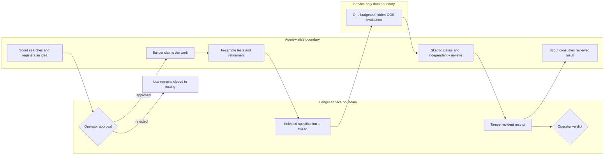

# SharpeShooter MVP architecture

SharpeShooter is a synchronous research-control ledger. In plain language, it gives each research role only the information and actions needed for its job, records every decision, and requires a separate reviewer before a result can reach the operator. Scout, Builder, and Skeptic workers coordinate only through six authenticated MCP tools. Real workers run with the user's ChatGPT subscription in a restricted container: read-only root, non-root user, dropped capabilities, explicit tool configuration, and no shell or host checkout.

## Reusable structured-task boundary

`sharpeshooter-task` is the project-owned intake used by Homework 8 and future orchestrators. `validate` strictly parses and canonicalizes a bounded task without creating runtime state. `run` requires the exact separately approved task digest, explicit OOS confirmation, trusted runtime paths, and a preselected operator verdict policy before constructing the ledger.

The runner creates one task idea, sends all agent actions through the authenticated FastAPI tool boundary, evaluates every candidate in-sample, evaluates only the exact selected specification out-of-sample, obtains an independent Skeptic review, lets a second Scout consume and verify the receipt, and only then applies the operator verdict. Task content never supplies those trusted authorities.

The authoritative Homework 8 path uses the deterministic synthetic evaluator and no model, sealed source, hidden OOS volume, or provider credential. Its receipt and audit trail demonstrate the controlled workflow, not strategy performance. Reviewer distribution uses a deterministic allowlist projection and an inventory-constrained wheel; archived Homework 6/7 content remains in the development repository but is excluded from the reproduction artifacts.

The service verifies staged IS data and keeps hidden OOS data in a service-only OOS volume that is never mounted into an agent workspace. Successful OOS work consumes a family budget, freezes the selected specification, requires a distinct reviewer, and produces a tamper-evident receipt. The evaluator is deliberately synthetic; it validates the selected split and exercises coordination controls, but it is not a backtester.

Operators manage the workflow locally. `sharpeshooter-admin set-policy` is the canonical policy command; the older `configure-policy` spelling remains accepted for compatibility. Agent credentials are issued once and are not written to audit history.

The automated demo capture is a redacted terminal transcript. The separate one-minute assignment video is a manual post-session deliverable.
